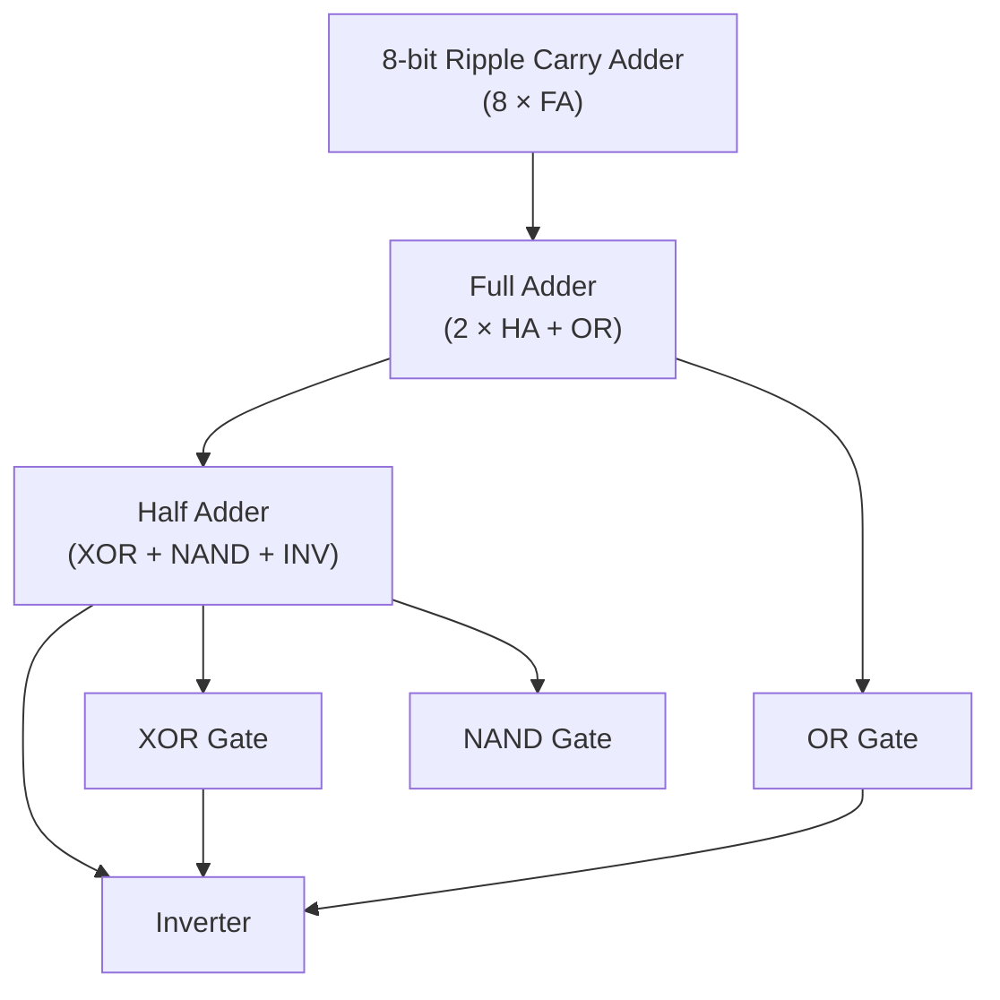

<div align="center">

# ⚡ 8-Bit Ripple Carry Adder
### Full-Custom CMOS Design in Cadence Virtuoso · 180 nm (gpdk180)

*From transistor-level schematics → DRC-clean layouts → transient & Monte Carlo analysis*


-blue)


</div>

---

## 📑 Table of Contents
1. [Overview](#-overview)
2. [Key Features](#-key-features)
3. [Design Hierarchy](#-design-hierarchy)
4. [Theory & Logic Equations](#-theory--logic-equations)
5. [Transistor-Level Design](#-transistor-level-design)
6. [Schematics](#-schematics)
7. [Layouts](#-layouts)
8. [Simulation Results](#-simulation-results)
9. [Design Summary](#-design-summary)
10. [Tools & Environment](#-tools--environment)
11. [Repository Structure](#-repository-structure)
12. [How to Reproduce](#-how-to-reproduce)
13. [Future Work](#-future-work)
14. [Author](#-author)

---

## 📌 Overview

This mini-project implements an **8-bit Ripple Carry Adder (RCA)** using a **bottom-up, full-custom design flow**. Every block, from the basic inverter to the final 8-bit adder, was designed at **transistor level**, laid out, verified with **DRC**, and then characterised with **transient** and **Monte Carlo** simulations.

The design is built hierarchically so that each lower-level cell is reused in the next level:

```
Inverter ─► NAND ─► OR ─► XOR ─► Half Adder ─► Full Adder ─► 8-bit Ripple Carry Adder
```

---

## ✨ Key Features

- ✅ Fully **transistor-level** CMOS implementation of every gate (no behavioural models)
- ✅ **Hierarchical design**: INV → NAND → OR → XOR → HA → FA → 8-bit RCA
- ✅ **Schematic + Layout** created for every cell
- ✅ **DRC clean**: *"No DRC errors found"* using **Assura DRC** on all layouts
- ✅ **Transient analysis** of all outputs (P0 – P8) using Spectre in ADE
- ✅ **Monte Carlo analysis** (100 samples) in ADE XL to study process variation
- ✅ Implemented in the **180 nm generic PDK (gpdk180)**

---

## 🧩 Design Hierarchy



---

## 📐 Theory & Logic Equations

### Half Adder
| A | B | Sum | Carry |
|:-:|:-:|:---:|:-----:|
| 0 | 0 | 0 | 0 |
| 0 | 1 | 1 | 0 |
| 1 | 0 | 1 | 0 |
| 1 | 1 | 0 | 1 |

```
Sum   = A ⊕ B
Carry = A · B   (implemented as NAND followed by INV)
```

### Full Adder
| A | B | Cin | Sum | Cout |
|:-:|:-:|:---:|:---:|:----:|
| 0 | 0 | 0 | 0 | 0 |
| 0 | 0 | 1 | 1 | 0 |
| 0 | 1 | 0 | 1 | 0 |
| 0 | 1 | 1 | 0 | 1 |
| 1 | 0 | 0 | 1 | 0 |
| 1 | 0 | 1 | 0 | 1 |
| 1 | 1 | 0 | 0 | 1 |
| 1 | 1 | 1 | 1 | 1 |

```
Sum  = A ⊕ B ⊕ Cin
Cout = A·B + Cin·(A ⊕ B)
```

Built from **two Half Adders + one OR gate**: HA1 adds `A + B`, HA2 adds the result with `Cin`, and the OR gate combines both carries.

### 8-bit Ripple Carry Adder
Eight Full Adders are chained so that `Cout` of stage *i* drives `Cin` of stage *i+1*:

```
S[i]    = A[i] ⊕ B[i] ⊕ C[i]
C[i+1]  = A[i]·B[i] + C[i]·(A[i] ⊕ B[i])
```

Outputs **P0 – P7** are the sum bits and **P8** is the final carry-out.

---

## 🔬 Transistor-Level Design

All devices use the minimum channel length of the 180 nm process (`L = 180 nm`).

| Cell | Topology | Transistors | PMOS W | NMOS W |
|------|----------|:-----------:|:------:|:------:|
| **Inverter** | Static CMOS | 2 | 2 µm | 1 µm |
| **NAND** | 2-input static CMOS | 4 | 2 µm | 1 µm |
| **OR** | NOR stage + Inverter | 6 | 2 µm | 1 µm |
| **XOR** | 4 PMOS + 4 NMOS + 2 input inverters (15 fF output load) | 12 | 2 µm | 1 µm |
| **Half Adder** | XOR + NAND + INV | 18 | – | – |
| **Full Adder** | 2 × HA + OR | 42 | – | – |
| **8-bit RCA** | 8 × FA | **336** | – | – |

---

## 🖼️ Schematics

| Inverter | NAND | OR |
|:---:|:---:|:---:|
|  |  |  |

| XOR | Half Adder |
|:---:|:---:|
|  |  |

| Full Adder |
|:---:|
|  |

### 8-bit Ripple Carry Adder (Top Level)


---

## 🏗️ Layouts

All layouts were drawn in **Virtuoso Layout Suite XL** and checked with **Assura DRC**. Every cell reports **"No DRC errors found."**

| Inverter | NAND |
|:---:|:---:|
|  |  |

| OR | XOR |
|:---:|:---:|
|  |  |

| Half Adder | Full Adder |
|:---:|:---:|
|  |  |

### 8-bit Ripple Carry Adder Layout (DRC Clean ✅)


### DRC Summary
| Cell | DRC Result |
|------|:----------:|
| Inverter | ✅ No errors |
| NAND | ✅ No errors |
| OR | ✅ No errors |
| XOR | ✅ No errors |
| Half Adder | ✅ No errors |
| Full Adder | ✅ No errors |
| 8-bit Ripple Carry Adder | ✅ No errors |

---

## 📈 Simulation Results

### 1️⃣ Transient Analysis
Transient simulation (`tran`, 0 – 100 ns) using **Spectre** in ADE L. All sum outputs **P0 – P7** and the carry-out **P8** were plotted in Virtuoso Visualization & Analysis XL.


### 2️⃣ Monte Carlo Analysis
Monte Carlo analysis was run in **ADE XL** with **100 samples**, varying process and mismatch parameters. The measured quantity is `ymax(VT("/Pn"))`, the peak output voltage on each output.


**Detailed histogram for the carry-out (P8):**


| Statistic (P8) | Value |
|----------------|:-----:|
| Samples | 100 |
| Mean (µ) | 1.85815 V |
| Std. Deviation (σ) | 3.899 mV |
| Skewness | −0.342 |
| Kurtosis | 0.709 |
| Jarque–Bera | 4.046 |

**Peak output voltage across all outputs** *(values read from the histograms)*:

| Output | Mean (V) | σ (approx.) |
|:------:|:--------:|:-----------:|
| P0 | 1.8157 | ~1.6 mV |
| P1 | 1.8212 | ~2.1 mV |
| P2 | 1.8190 | ~2.0 mV |
| P3 | 1.8185 | ~2.0 mV |
| P4 | 1.8183 | ~2.0 mV |
| P5 | 1.8183 | ~2.0 mV |
| P6 | 1.8183 | ~2.0 mV |
| P7 | 1.8183 | ~2.0 mV |
| P8 (Cout) | 1.8582 | 3.9 mV |

**Observation:** The spread of the output voltage stays within a few millivolts across all 100 samples, and the Jarque–Bera value for P8 is low (≈ 4), which indicates a distribution close to Gaussian. This shows the adder is robust against process variation.

---

## 📊 Design Summary

| Parameter | Details |
|-----------|---------|
| Technology | gpdk180 (180 nm) |
| Adder width | 8 bits |
| Architecture | Ripple carry (8 cascaded full adders) |
| Total transistors | 336 |
| Channel length | 180 nm |
| PMOS / NMOS width | 2 µm / 1 µm |
| Verification | Schematic simulation, DRC, Monte Carlo |
| DRC | Clean on all cells |
| Monte Carlo samples | 100 |

---

## 🛠️ Tools & Environment

| Purpose | Tool |
|---------|------|
| Schematic capture | Cadence Virtuoso Schematic Editor L / XL |
| Layout | Cadence Virtuoso Layout Suite XL |
| Physical verification | Cadence Assura DRC |
| Simulation | Spectre (ADE L) |
| Monte Carlo | ADE XL |
| Waveform viewer | Virtuoso Visualization & Analysis XL |
| Process design kit | gpdk180 (180 nm) |
| Virtuoso version | 6.1.8-64b |

---

## 📁 Repository Structure

```
8bit-ripple-carry-adder/
│
├── README.md
├── docs/
│   └── images/
│       ├── schematic/
│       │   ├── 01_inv_schematic.png
│       │   ├── 02_nand_schematic.png
│       │   ├── 03_or_schematic.png
│       │   ├── 04_xor_schematic.png
│       │   ├── 05_half_adder_schematic.png
│       │   ├── 06_full_adder_schematic.png
│       │   └── 07_8bit_ripple_schematic.png
│       ├── layout/
│       │   ├── 08_inv_layout.png
│       │   ├── 09_nand_layout.png
│       │   ├── 10_or_layout.png
│       │   ├── 11_xor_layout.png
│       │   ├── 12_half_adder_layout.png
│       │   ├── 13_full_adder_layout.png
│       │   └── 14_8bit_ripple_layout.png
│       └── simulation/
│           ├── 15_transient_response.png
│           ├── 16_monte_carlo_P0_P7.png
│           └── 17_monte_carlo_P8.png
│
└── ripple/                  # Virtuoso library (optional)
    ├── inv/
    ├── nand/
    ├── or/
    ├── xor/
    ├── half_adder/
    ├── full_adder/
    └── 4bit_ripple/         # top cell containing the 8-bit adder
```

---

## ▶️ How to Reproduce

1. Open Virtuoso and create / import the library `ripple` attached to the **gpdk180** technology.
2. Open the schematic of each cell, check and save it (`Check → Current Cellview`).
3. Open the layout view and run **Assura → Run DRC**.
4. For the top cell, open **ADE L**, select **Spectre**, add the input pulse sources, set the transient stop time to `100n`, and run.
5. For variation analysis, open **ADE XL**, create a **Monte Carlo Sampling** run with `100` samples, and add `ymax(VT("/Pn"))` as the output expressions.
6. Plot the results in **Visualization & Analysis XL**.

---

## 🚀 Future Work

- [ ] LVS verification of all layouts
- [ ] Parasitic extraction (PEX) and post-layout simulation
- [ ] Propagation delay and power measurement
- [ ] Carry-lookahead / carry-select adder for speed comparison
- [ ] Transistor sizing optimisation for lower delay

---

## 👤 Author

**[Your Name]**
[Your Department / College]
📧 [your-email@example.com] · 🔗 [LinkedIn](https://linkedin.com/in/your-profile) · 💻 [GitHub](https://github.com/your-username)

---

<div align="center">

⭐ *If you found this project useful, consider giving it a star!* ⭐

</div>
